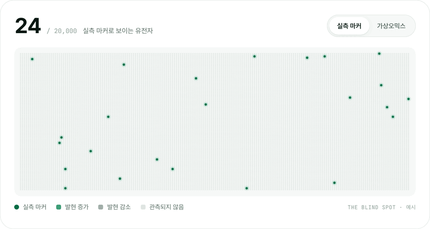
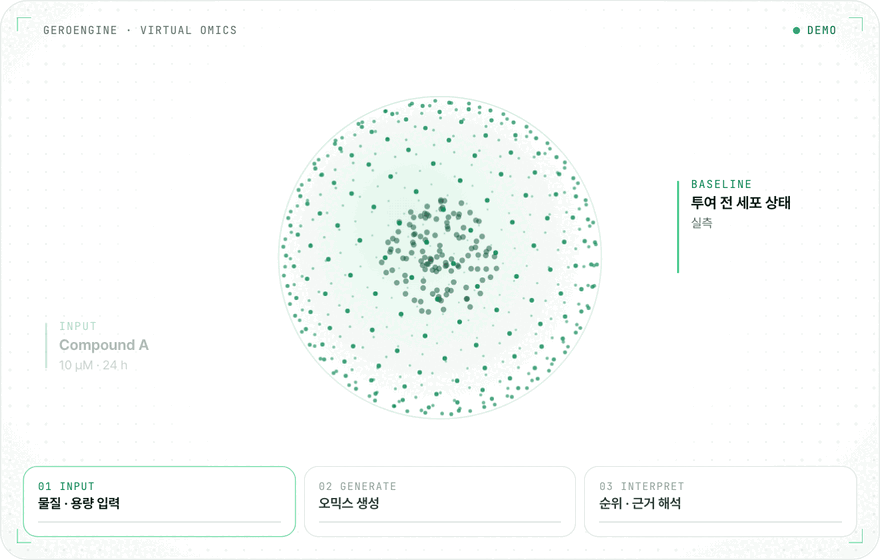

# 에이징랩 AgingLab

### 실험 전에, 답을 먼저.

물질을 투여한 뒤의 오믹스 변화를 AI로 먼저 생성해, 
될 후보에만 실험하도록 돕는 가상오믹스 기업입니다.

[English](https://github.com/aging-lab) · **한국어**

---

## 👋 회사 소개

에이징랩은 **UNIST 생정보학 연구에서 출발한 교원창업기업**입니다 (2023년 6월 12일 설립).
세계 최초 게놈들을 해독해 온 오믹스 연구를 바탕으로, 물질 투여 후 세포 변화를 계산하는 **가상오믹스 플랫폼**을 만듭니다.

**미션** — 모든 실험이 될 후보에 쓰이도록. 
**비전** — 계산으로 시작하는 연구, 정밀의료까지 이어갑니다.

## 🔭 왜 가상오믹스인가

약이 들어가면 세포 안의 유전체 · 전사체 · 단백체 · 대사체가 함께 움직입니다.
하지만 실제로 측정하는 마커는 많아야 수십 개이고, 나머지 변화는 보지 못한 채 다음 단계로 넘어갑니다.
**전부 실측할 수 없다면, 전부 계산해서 보면 됩니다.**

<picture>
  <source media="(prefers-color-scheme: dark)" srcset="https://raw.githubusercontent.com/aging-lab/.github/main/profile/assets/blind-spot-ko-dark.gif">
  
</picture>
 실측 마커 24개 vs. 가상오믹스 20,000개 유전자 (예시)

## 🧬 작동 원리

<picture>
  <source media="(prefers-color-scheme: dark)" srcset="https://raw.githubusercontent.com/aging-lab/.github/main/profile/assets/virtual-omics-ko-dark.gif">
  
</picture>
 <b>01 입력</b> 물질 · 용량 · 시간 → <b>02 생성</b> 투여 후 유전자 변화 Δ → <b>03 해석</b> 효과 경로 · 주의 신호 · 다음 실험

 

| 플랫폼 | 설명 |
|---|---|
| **가상오믹스** Virtual Omics | 물질 · 용량 · 시간을 입력하면 AI가 투여 후 유전자 발현 변화를 생성합니다. 후보 순위와 선택 이유, 다음 실험까지 근거와 함께 제공합니다. |
| **GeroEngine** 생성 엔진 | 자체 온프레미스 GPU 클러스터에서 구동되는 가상오믹스 생성 엔진입니다. 고객 데이터를 외부로 반출하지 않고 분석할 수 있습니다. |
| **AgingAtlas** 데이터 백본 | 논문 · 약물 · 실험 자료와 직접 생산한 사람 조직 실측 오믹스를 하나의 기준으로 연결한 근거 데이터 백본입니다. |

**학습 루프** — `ATLAS → ENGINE → DECIDE → VALIDATE ↺` 과제마다 나오는 실측 결과가 다시 학습 데이터가 되어, 쓸수록 정확해집니다.

| **0.87 PCC** | **2,000종 / 약 10시간** | **34만 건** | **1,229건** |
|:---:|:---:|:---:|:---:|
| 생성 정확도 사내 검증 | 1회 스크리닝 처리량 온프레미스 GPU | 생물학적 근거 연결 AgingAtlas | 사람 조직 실측 오믹스 자체 생산 |

**검증 성과** — 천연물 · 식품 유래 후보 2,000종을 한 번에 비교해, 질환 관련 작용과 유전자 변화 패턴을 모두 충족한 근감소증 후보 18종을 도출했습니다. 물질과 용도는 특허 출원했습니다.

## 🔬 서비스

- **가상오믹스 분석** — 물질 작용 분석 · 후보 스크리닝 · 오믹스 기반 검증 실험 설계 · 오믹스 커스텀 분석 환경
- **NGS 분석** — WGS / WES · RNA-seq · Methyl-seq · scRNA-seq · Long-read
- **정밀 오믹스 분석** — T2T gapless 어셈블리 · 다중오믹스 정밀 분석 · 전사체 / 메틸체 분석 · 암 오믹스 분석 · 싱글셀 오믹스 분석 · 오믹스 기반 논문 작성

**활용 분야** — 건강기능식품 · 소재 / 신약 타겟 · 물질 발굴 / 임상 · 바이오마커 연구 / 정밀의료 · 개인 맞춤

## 📚 연구

연구진 SCI(E) 논문 **82편** · 특허 **16건** (등록 · 출원 · 이전). 대표 논문:

- **Korea4K** — *GigaScience* (2024)
- **Korean Genome Project** — *Science Advances* (2020)
- **Korean reference genome** — *Nature Communications* (2016)
- **Ancient Ethiopian genome** — *Science* (2015)
- **Minke whale genome** — *Nature Genetics* (2014)

벤처기업(혁신성장유형) · 기업부설연구소(한국산업기술진흥협회 인정) · 기술평가 우수기업 T5(한국기술신용평가) · 전문연구사업자

## 📮 문의

| 구분 | 연락처 |
|---|---|
| 분석 · 기술 문의 | [jsungwon@aginglab.com](mailto:jsungwon@aginglab.com) |
| 사업 · 제휴 문의 | [suanbio@aginglab.com](mailto:suanbio@aginglab.com) |
| 본사 | (44919) 울산광역시 울주군 언양읍 유니스트길 50, UNIST 251동 322호 |
| 기업부설연구소 | (16226) 경기도 수원시 영통구 대학로 56, 리치프라자1 404호 |

© 에이징랩 주식회사 · <a href="https://aginglab.com">aginglab.com</a>

