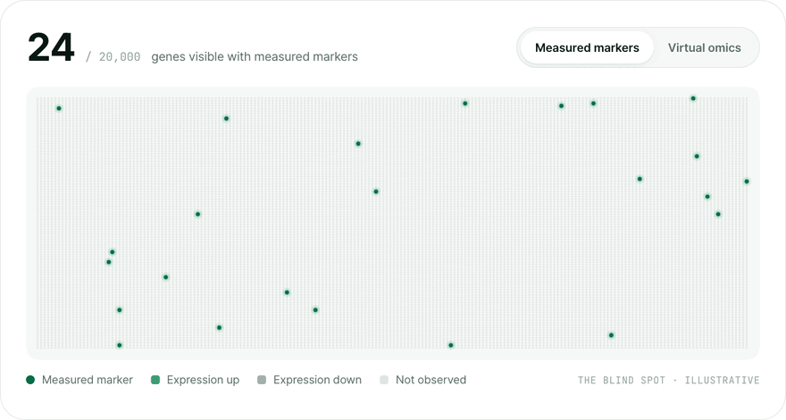
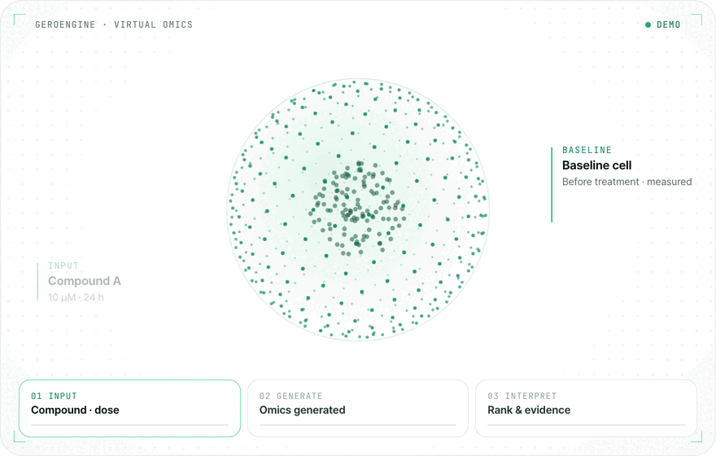

# AgingLab

### The answer, before the experiment.

AgingLab uses AI to generate how omics change after a compound is given, 
so experiments go only to the candidates that matter.

**English** · [한국어](https://github.com/aging-lab/.github/blob/main/profile/README.ko.md)

---

## 👋 About

AgingLab is a **UNIST faculty start-up** founded on 12 June 2023.
On top of omics research that decoded world-first genomes, we build a **virtual-omics platform** that computes how cells change after a compound is given.

**Mission** — Every experiment, on a candidate worth testing. 
**Vision** — Research that starts with computation, all the way to precision medicine.

## 🔭 Why virtual omics

When a compound enters a cell, its genome, transcriptome, proteome and metabolome shift together.
Yet only a few dozen markers are usually measured, and the rest of the response goes unseen into the next stage.
**If you can't measure everything, compute everything.**

<picture>
  <source media="(prefers-color-scheme: dark)" srcset="https://raw.githubusercontent.com/aging-lab/.github/main/profile/assets/blind-spot-en-dark.gif">
  
</picture>
 24 measured markers vs. 20,000 genes with virtual omics (illustrative)

## 🧬 How it works

<picture>
  <source media="(prefers-color-scheme: dark)" srcset="https://raw.githubusercontent.com/aging-lab/.github/main/profile/assets/virtual-omics-en-dark.gif">
  
</picture>
 <b>01 INPUT</b> compound · dose · time → <b>02 GENERATE</b> post-treatment gene change Δ → <b>03 INTERPRET</b> effect pathways · caution signals · next experiment

 

| Platform | Description |
|---|---|
| **Virtual Omics** | Enter a compound, dose and time, and AI generates the gene-expression change after treatment. You get ranked candidates, the reasons behind them and the next experiment to run. |
| **GeroEngine** | The virtual-omics engine, running on our own on-premise GPU cluster. Analysis can run on-premise, so your data never has to leave your organisation. |
| **AgingAtlas** | Our evidence backbone, linking literature, drug and experimental data with human-tissue omics we generated ourselves. |

**Learning loop** — `ATLAS → ENGINE → DECIDE → VALIDATE ↺` Measured results from every project become training data again, so the engine gets more accurate with use.

| **0.87 PCC** | **2,000 compounds / ~10 h** | **340K** | **1,229** |
|:---:|:---:|:---:|:---:|
| Generation accuracy in-house validation | Screened in a single run on-premise GPUs | Biological evidence links AgingAtlas | Human-tissue omics generated in-house |

**Validation** — We compared 2,000 natural and food-derived candidates at once and selected 18 sarcopenia candidates that met both disease-relevant action and gene-change pattern. The compounds and their use have been filed for patent.

## 🔬 Services

- **Virtual omics analysis** — Compound insight · Candidate screening · Omics-based validation design · Custom omics analysis environment
- **NGS analysis** — WGS / WES · RNA-seq · Methyl-seq · scRNA-seq · Long-read
- **Precision omics** — T2T gapless assembly · Multi-omics · Transcriptome & methylome · Cancer omics · Single-cell omics · Omics-based manuscripts

**Applications** — Functional foods & ingredients · Drug target & compound discovery · Clinical & biomarker research · Precision medicine

## 📚 Research

**82** SCI(E) papers by our researchers · **16** patents granted, filed & licensed. Selected publications:

- **Korea4K** — *GigaScience* (2024)
- **Korean Genome Project** — *Science Advances* (2020)
- **Korean reference genome** — *Nature Communications* (2016)
- **Ancient Ethiopian genome** — *Science* (2015)
- **Minke whale genome** — *Nature Genetics* (2014)

Venture company (innovation-growth type) · Corporate R&D center (KOITA accredited) · Technology rating T5 (Korea Technology Credit Bureau) · Specialized research business

## 📮 Contact

| Inquiry | Contact |
|---|---|
| Analysis & technology | [jsungwon@aginglab.com](mailto:jsungwon@aginglab.com) |
| Business & partnership | [suanbio@aginglab.com](mailto:suanbio@aginglab.com) |
| HQ | UNIST Bldg 251, Rm 322, 50 UNIST-gil, Eonyang-eup, Ulju-gun, Ulsan 44919, Korea |
| R&D Center | Rich Plaza 1, Rm 404, 56 Daehak-ro, Yeongtong-gu, Suwon, Gyeonggi 16226, Korea |

© AgingLab Inc. · <a href="https://aginglab.com">aginglab.com</a>

