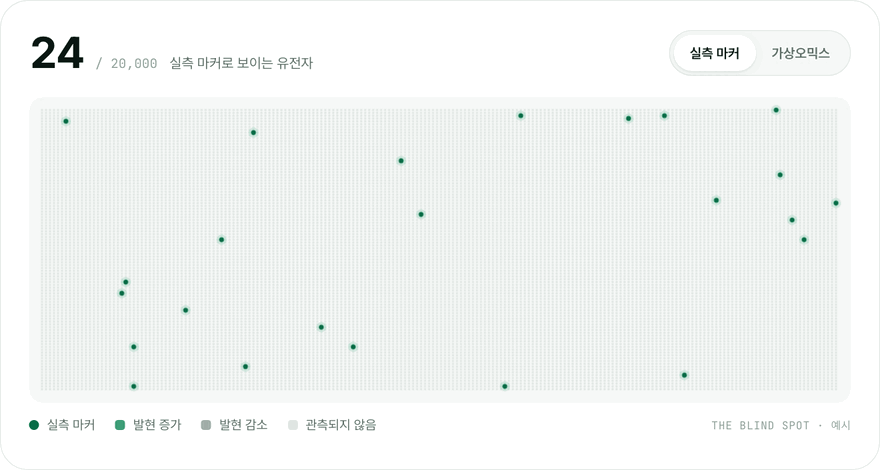
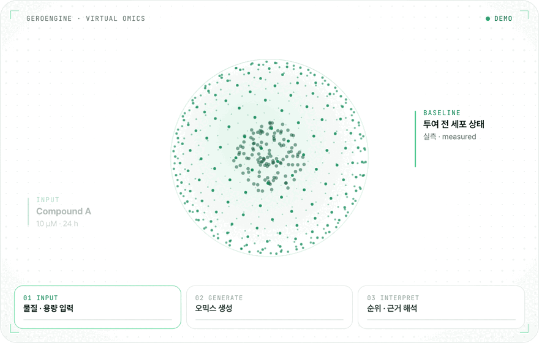

# AgingLab · 에이징랩

### 실험 전에, 답을 먼저.
**The answer, before the experiment.**

물질을 투여한 뒤의 오믹스 변화를 AI가 먼저 생성해, 실험은 될 후보에만 쓰이도록 합니다. 
*We use AI to generate how omics change after a compound is given, so experiments go only to the candidates that matter.*

---

## 👋 About

에이징랩은 **UNIST 생정보학 연구에서 출발한 교원창업기업**입니다 (2023. 6. 12 설립).
세계 최초 게놈들을 해독해 온 오믹스 연구를 바탕으로, 물질 투여 후 세포 변화를 계산하는 **가상오믹스(Virtual Omics) 플랫폼**을 만듭니다.

> AgingLab is a UNIST faculty start-up. On top of omics research that decoded world-first genomes,
> we build a virtual-omics platform that computes how cells change after a compound is given.

**Mission** — 모든 실험이 될 후보에 쓰이도록. *Every experiment, on a candidate worth testing.* 
**Vision** — 계산으로 시작하는 연구, 정밀의료까지. *Research that starts with computation, all the way to precision medicine.*

## 🔭 Why virtual omics

약이 들어가면 세포 안의 유전체 · 전사체 · 단백체 · 대사체가 함께 움직이지만, 실제로 측정하는 마커는 많아야 수십 개입니다.
**전부 실측할 수 없다면, 전부 계산해서 보면 됩니다.**

> Drugs are built on a handful of markers. *If you can't measure everything, compute everything.*

<picture>
  <source media="(prefers-color-scheme: dark)" srcset="https://raw.githubusercontent.com/aging-lab/.github/main/profile/assets/blind-spot-dark.gif">
  
</picture>
 실측 마커 24개 vs. 가상오믹스 20,000개 유전자 · Measured markers vs. virtual omics (illustrative)

## 🧬 How it works

<picture>
  <source media="(prefers-color-scheme: dark)" srcset="https://raw.githubusercontent.com/aging-lab/.github/main/profile/assets/virtual-omics-dark.gif">
  
</picture>
 <b>01 INPUT</b> 물질 · 용량 · 시간 → <b>02 GENERATE</b> 투여 후 유전자 변화 Δ 생성 → <b>03 INTERPRET</b> 효과 경로 · 주의 신호 · 다음 실험

 

| Platform | Description |
|---|---|
| **Virtual Omics** 가상오믹스 | 물질 · 용량 · 시간을 넣으면 투여 후 유전자 발현 변화(Δ gene expression)를 AI로 생성합니다. 후보 순위, 선택 근거, 다음 실험까지 함께 제시합니다. |
| **GeroEngine** 생성 엔진 | 자체 온프레미스 GPU 클러스터에서 구동되는 가상오믹스 생성 엔진. 고객 데이터를 외부로 반출하지 않고 분석할 수 있습니다. |
| **AgingAtlas** 데이터 백본 | 논문 · 약물 · 실험 자료와 직접 생산한 사람 조직 실측 오믹스를 하나의 기준으로 연결한 근거 데이터 백본입니다. |

**Learning loop** — `ATLAS → ENGINE → DECIDE → VALIDATE ↺` 과제마다 나오는 실측 결과가 다시 학습 데이터가 되어, 쓸수록 정확해집니다.

| **0.87 PCC** | **2,000 compounds / ~10 h** | **340K** | **1,229** |
|:---:|:---:|:---:|:---:|
| 생성 정확도 (사내 검증) Generation accuracy (in-house) | 1회 스크리닝 처리량 Single-run screening | 생물학적 근거 연결 Biological evidence links | 자체 생산 사람 조직 오믹스 In-house human-tissue omics |

**Validation** — 천연물 · 식품 유래 후보 2,000종을 한 번에 비교해 근감소증(sarcopenia) 후보 18종을 도출했고, 물질과 용도를 특허 출원했습니다.

## 🔬 Services

- **가상오믹스 분석 · Virtual omics analysis** — 물질 작용 분석 · 후보 스크리닝 · 오믹스 기반 검증 실험 설계 · 오믹스 커스텀 분석 환경
- **NGS 분석 · NGS analysis** — WGS / WES · RNA-seq · Methyl-seq · scRNA-seq · Long-read
- **정밀 오믹스 분석 · Precision omics** — T2T gapless 어셈블리 · 다중오믹스 · 전사체 / 메틸체 · 암 오믹스 · 싱글셀 오믹스 · 오믹스 기반 논문 작성

**Applications** — 건강기능식품 · 소재 / 신약 타겟 · 물질 발굴 / 임상 · 바이오마커 연구 / 정밀의료 · 개인 맞춤

## 📚 Research

연구진 SCI(E) 논문 **82편**, 특허 **16건** (등록 · 출원 · 이전). 대표 논문:

- **Korea4K** — *GigaScience* (2024)
- **Korean Genome Project** — *Science Advances* (2020)
- **Korean reference genome** — *Nature Communications* (2016)
- **Ancient Ethiopian genome** — *Science* (2015)
- **Minke whale genome** — *Nature Genetics* (2014)

벤처기업(혁신성장유형) · 기업부설연구소(KOITA) · 기술평가 T5(한국기술신용평가) · 전문연구사업자

## 📮 Contact

| 구분 · Inquiry | Contact |
|---|---|
| 분석 · 기술 문의 · Analysis & technology | [jsungwon@aginglab.com](mailto:jsungwon@aginglab.com) |
| 사업 · 제휴 문의 · Business & partnership | [suanbio@aginglab.com](mailto:suanbio@aginglab.com) |
| 본사 · HQ | UNIST 251동 322호, 울산광역시 울주군 언양읍 유니스트길 50 |
| 기업부설연구소 · R&D Center | 리치프라자1 404호, 경기도 수원시 영통구 대학로 56 |

© AgingLab Inc. · <a href="https://aginglab.com">aginglab.com</a>

